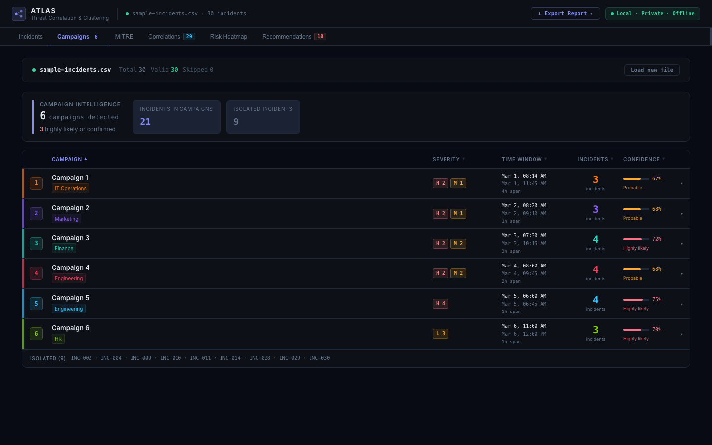
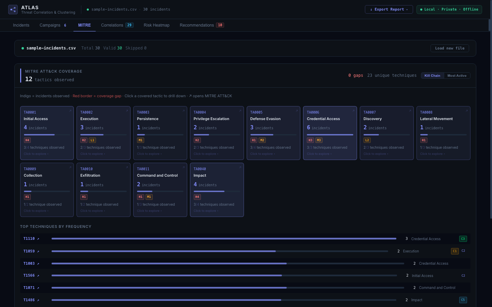
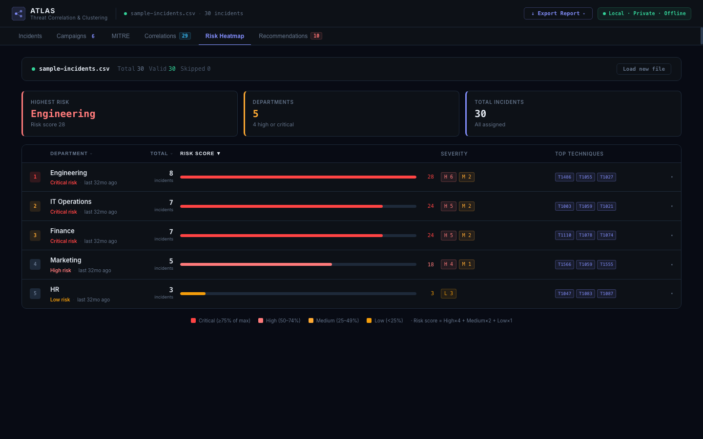

# ATLAS — Threat Correlation & Clustering Framework


<p align="center"></p>

---

## Overview

ATLAS is a local, privacy-first threat correlation and clustering framework for SOC analysts and incident responders. Upload a CSV export of Microsoft Defender incidents and ATLAS automatically:

- **Sanitizes PII** — usernames, hostnames, and IPs are SHA-256 hashed before any processing
- **Correlates incidents** using weighted scoring: entity overlap (35%), MITRE technique similarity (30%), temporal proximity (25%), severity alignment (10%)
- **Clusters campaigns** using DBSCAN unsupervised machine learning to surface coordinated attack patterns
- **Maps MITRE ATT&CK coverage** — shows which tactics are detected vs blind spots, with severity breakdown and technique coverage fractions
- **Builds a departmental risk heatmap** — identifies highest-risk departments with drill-down to individual incidents
- **Generates hardening recommendations** — prioritised, actionable controls derived from cluster findings, tactic gaps, and department risk
- **Exports a professional PDF report** — two-page executive briefing + technical detail, ready to present to leadership

Runs entirely on localhost. No cloud dependencies, no API keys, no data leaves your machine.

---

## Screenshots

<p align="center">&nbsp;</p>

<p align="center"><sub>MITRE ATT&CK coverage · Departmental risk heatmap</sub></p>

---

## Tabs

| Tab | What it does |
|---|---|
| **Incidents** | Sortable, filterable table of all incidents — search by ID, title, technique, department, or campaign. Keyboard-navigable with arrow keys. |
| **Campaigns** | Expandable campaign table with 5-tier confidence scale (Confirmed / Highly likely / Probable / Possible / Weak signal), severity breakdown, and full campaign explainer |
| **MITRE ATT&CK** | Tactic grid with incident counts, severity breakdown, technique coverage fractions, and gap analysis |
| **Correlations** | Ranked correlation pairs with shared signals, adjustable threshold slider, strength filters, and campaign context |
| **Risk Heatmap** | Departmental risk ranked by severity-weighted score (High×4 · Medium×2 · Low×1), with incident drill-down and campaign badges |
| **Recommendations** | Prioritised hardening actions with source attribution, collapsible detail, and priority/source filters |

---

## Stack

| Layer | Technology |
|---|---|
| Backend | Python 3.12 / Flask |
| Data processing | pandas, scikit-learn (DBSCAN), numpy |
| Input validation | jsonschema |
| Frontend | React 18 + Vite (inline styles — no CSS framework) |
| Security | SHA-256 PII hashing, JSON Schema input validation, CORS locked to localhost |

---

## Setup

### Prerequisites
- Python 3.12 (`brew install python@3.12`)
- Node.js v18+

### Install
```bash
# Backend
cd backend
/opt/homebrew/bin/python3.12 -m venv venv
source venv/bin/activate
pip install -r requirements.txt

# Frontend
cd ../frontend && npm install
```

### Start
Double-click `start-atlas.command` or run manually:
```bash
# Terminal 1
cd backend && source venv/bin/activate && python server.py

# Terminal 2
cd frontend && npm run dev
```

Open **http://localhost:5173**

---

## Privacy & Security

- All PII hashed with SHA-256 before any processing — raw values never stored or transmitted
- `Comments` and `Payload` fields dropped at ingestion — never processed
- Optional salt configurable in `backend/.env` for non-reversible hashing
- Strict JSON Schema validation at ingestion — malformed rows skipped and logged
- No LLM in the core pipeline — no prompt injection surface
- No data leaves localhost at any point

---

## PDF Export

ATLAS generates a two-page print-ready report:

**Page 1 — Executive Briefing**
Overall risk level (Critical / High / Medium), key metrics, auto-generated narrative summary, campaign table with confidence verdicts, departmental risk exposure, and prioritised actions with ownership and timeframes.

**Page 2 — Technical Report**
Full campaign detail with MITRE techniques, complete ATT&CK coverage matrix, full hardening recommendations with evidence citations, and top correlated incident pairs with shared signals.

Both pages include the analysis date range, confidence verdict labels, and a privacy footer confirming all PII is hashed.

---

## Correlation Algorithm

ATLAS builds a pairwise similarity matrix across all incidents using four weighted signals:

| Signal | Weight | Method |
|---|---|---|
| Shared entities (user/host/IP) | 35% | Jaccard similarity on hashed entity sets |
| MITRE technique overlap | 30% | Jaccard similarity on technique sets |
| Temporal proximity | 25% | Exponential decay within 72h window |
| Severity alignment | 10% | Normalised difference in severity weights |

Incidents scoring above the correlation threshold are passed to DBSCAN, which discovers campaign clusters without requiring a predefined number of clusters. Outliers are labeled as isolated incidents.

---

## Future — Live Graph API Integration

When organisational approval is granted, the CSV ingestion layer can be swapped for a live Microsoft Graph API pull. The entire analysis, clustering, and UI layer remains unchanged. Required permissions (read-only):

| Permission | Justification |
|---|---|
| `SecurityIncident.Read.All` | Read Defender incidents |
| `SecurityAlert.Read.All` | Read alert evidence and entity data |
| `IdentityInfo.Read.All` | Resolve department for risk heatmap |
| `User.Read.All` | UPN to department mapping |

No write permissions. No Global Admin. See `SPEC.md` for full KQL queries and threat model.

---

## Sample Data

A `sample-incidents.csv` file is included in the repository root for testing and demonstration purposes. All data is synthetic — no real incidents, no real PII.

---

*Built by Julius Garza — SOC analyst tooling for threat correlation, campaign detection, and security briefing generation.*
